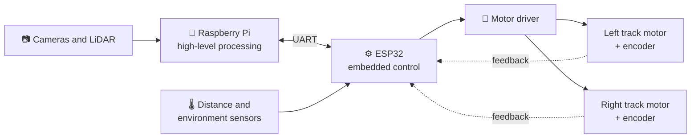
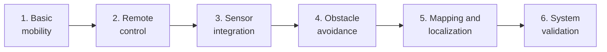

<div align="center">

#  Tank Rover

### AI-Powered Subterranean Exploration and Rescue System
**Application ID: VK26-IITH-SM-0043**


[](https://rover-chasis.vercel.app/)
[](CAD.md)
[](schematic.md)
[](https://drive.google.com/drive/folders/1EkdNMd7naFCUVERvC5URtl4ZttO6ABKr?usp=sharing)

</div>

---

## 🧭 Quick navigation

| I want to... | Go here |
| :-- | :-- |
| 👀 **See the rover in 3D** | [Live 3D model](https://rover-chasis.vercel.app/) |
| 🛠️ **Open or rebuild the CAD model** | [CAD.md](CAD.md) |
| 🔌 **Open the schematic diagram** | [schematic.md](schematic.md) |
| 📁 **Browse all files** | [Repository structure](#-repository-structure) |

---

## 📖 Overview

The Tank Rover is a tracked mobile robotic platform being developed as part of the **Vishwakarma Awards initiative**. The project aims to develop a compact, modular, and cost-effective robotic system capable of controlled movement, obstacle detection, environmental sensing, and future expansion toward indoor mapping and autonomous navigation.

The platform uses a **Raspberry Pi for high-level processing** and an **ESP32 for low-level hardware control and peripheral interfacing**. This separation enables computationally intensive tasks to be handled independently from time-sensitive control operations.

The rover is built around a tracked chassis, providing a practical platform for movement across varied indoor surfaces and uneven terrain within the limits of its mechanical design.

---

## 🧠 System architecture

The rover follows a two-level control architecture.



*Planned architecture. The final communication protocol and command format will be documented as the system design is finalized.*

<details>
<summary><b>🧠 Raspberry Pi — high-level processing</b> (click to expand)</summary>

<br>

The Raspberry Pi serves as the rover's primary computing platform. Its responsibilities may include:

- Processing high-level movement commands.
- Coordinating sensor data and system-level logic.
- Implementing obstacle avoidance and navigation algorithms.
- Supporting future mapping and localization capabilities.
- Handling communication with a remote control interface, where implemented.

</details>

<details>
<summary><b>⚙️ ESP32 — embedded control</b> (click to expand)</summary>

<br>

The ESP32 handles hardware-level control and interfaces with the rover's peripherals. Its responsibilities may include:

- Receiving movement commands from the Raspberry Pi.
- Generating control signals for the motor driver.
- Controlling the left and right track drive systems.
- Reading supported sensors and reporting measurements.
- Managing low-level communication and basic safety responses.

</details>

<details>
<summary><b>🔗 Communication between controllers</b> (click to expand)</summary>

<br>

A suitable interface, such as UART, will connect the Raspberry Pi and ESP32. The final communication protocol and command format will be documented as the system design is finalized.

</details>

---

## 🎯 Project objectives

<details>
<summary><b>Click to see all 7 objectives</b></summary>

<br>

- [ ] Develop a functional tracked mobile rover with reliable movement and steering.
- [ ] Implement differential steering by independently controlling the left and right track drive systems.
- [ ] Integrate motor drivers, power management, and embedded control electronics.
- [ ] Interface with sensors for distance measurement and obstacle detection.
- [ ] Establish communication between the Raspberry Pi and ESP32 for high-level commands and low-level control.
- [ ] Create a modular hardware and software architecture that supports future upgrades.
- [ ] Provide a foundation for indoor mapping, localization, and autonomous navigation.

</details>

---

## 🗺️ Planned development

Development will proceed incrementally:



| Stage | Goal |
| :-- | :-- |
| **1. Basic mobility** | Establish reliable forward, reverse, turning, and stopping operations. |
| **2. Remote control** | Enable command-based rover operation and verify communication between the controllers. |
| **3. Sensor integration** | Add and validate distance measurement and obstacle detection. |
| **4. Obstacle avoidance** | Implement and test reactive obstacle-avoidance behaviour. |
| **5. Mapping and localization** | Explore indoor spatial mapping and position estimation, subject to the available sensors and processing capabilities. |
| **6. System validation** | Evaluate movement, control reliability, sensor performance, and overall system behaviour. |

> [!NOTE]
> These stages describe the intended development path. Capabilities will be marked as implemented only after testing.

---

## 📁 Repository structure

```text
.
├── README.md          📖 Project overview (this file)
├── schematic.md       🔌 How to open the schematic diagram
├── CAD.md             🛠️ How to view the CAD model and run an FEA
└── assets/
    ├── schematic/     EasyEDA project and schematic PDF
    ├── cad/           CAD files
    └── bom/           Bill of materials
```

---

## 🧩 Design approach

The project follows a modular engineering approach:

**Design → Implement → Test → Document → Improve**

Hardware interfaces and software components will be documented to simplify debugging, integration, maintenance, and future expansion. The repository serves as the central technical record of the rover's design, implementation, and development progress.

---

## 👥 Developers

<table align="center">
  <tr>
    <td align="center"><a href="https://github.com/VISHNU-KAUSHIK-S"><br><b>Vishnu Kaushik S</b></a></td>
    <td align="center"><a href="https://github.com/kevinraymond93"><br><b>Kevin Raymond</b></a></td>
    <td align="center"><a href="https://github.com/arnav-rath11/arnav-rath11"><br><b>Arnav Rath</b></a></td>
    <td align="center"><a href="https://github.com/Vikas-Dk-2005"><br><b>Vikas D K</b></a></td>
  </tr>
</table>

---

<div align="center">

**Built for the Vishwakarma Awards 2026-27**

[⬆ Back to top](#-tank-rover)

</div>
